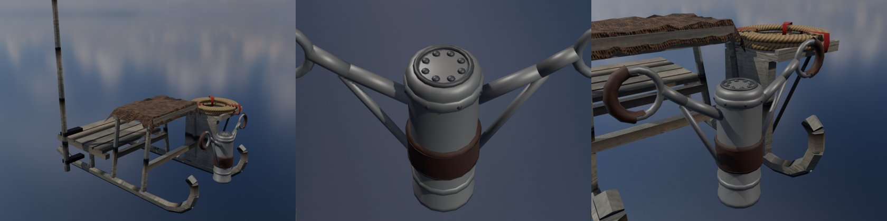

# Ice-age valley: Ring-fence (buzul)

A snowy tundra valley between glacier walls. The last mammoth herd (five adults and a calf) stands in the middle; wolves wait at the edges. In front of the player twelve post spots ring the herd; on the left a pile of sharpened stakes and a mallet, on the right a stack of split planks, behind a small fire for the coming night.

- Game file: `public/v2/buzul/buzul.glb` (1.3 MB, Draco + KTX2; loading as in `art/v2/mahalle/README.md`)
- Build: `art/v2/buzul/build.py`
- Previews: `art/v2/buzul/preview/*.jpg`; numbers: `stats.json`, `pack-report.json`

Units metres, glTF Y-up, build-script north = three.js -Z. The herd's centre is 8.5 m north of the origin; the player sits 2.5 m south of the origin.

## Budget

56,500 triangles drawn (the six mammoths share one 4,500-triangle mesh and the four wolves one 2,500-triangle mesh), 55 draw calls (most are the 12 stakes and 12 planks, each its own node), 1.2 MB of textures, 1.3 MB in all.

## Named nodes

| Node | What | Pivot / notes |
|---|---|---|
| `mammoth_1` … `mammoth_6` | woolly mammoths, about 5 m long and 3 m high (`mammoth_6` is a calf at 0.62 scale) | on the ground under the body centre; walk them by moving the node. Static pose, no rig |
| `wolf_1` … `wolf_4` | wolves at 18-30 m (one behind the player to the east) | on the ground under the body centre; static pose |
| `stake_01` … `stake_12` | sharpened stakes, 1.7 m, lying in the pile | the blunt end; the stake runs along local +X to its point. To plant one, stand it point down at a `post_spot_*` |
| `plank_01` … `plank_12` | split planks, 4.28 m (the gap between posts is 3.88 m) | one end; the plank runs along local +X |
| `mallet` | wooden mallet for driving stakes | the handle's end |
| `campfire_embers` | glowing embers (emissive) | fire effects go at `campfire_flame` |

## Points

| Point | Where |
|---|---|
| `seat_valley` | the player's floor point, facing the herd (north; forward = local -Z) |
| `post_spot_01` … `post_spot_12` | where the stakes go: a ring of radius 7.5 m around the herd, 3.88 m apart, starting due south; each faces along the ring |
| `herd_centre` | middle of the ring |
| `stake_pile`, `plank_pile` | the two piles (left and right of the seat) |
| `campfire_flame` | above the fire, behind the seat |

## Notes for the game

- No lights in the file. Day: a cold low sun and pale fog. Night (the loss condition): blue moonlight, the campfire as the only warm light.
- Wolves look for a gap between posts: `post_spot_*` order gives the ring's segments (spot k to k+1, and 12 back to 1).

## Rebuilding

```bash
python3 art/v2/tools/fetch_tex.py "$V2_CACHE" 1k snow_03 snow_02 dark_rock bark_brown_02 old_wood_floor
```

```bash
python3 art/v2/tools/sketchfab.py get "$V2_CACHE" fce1c86ccedf47a5b9627098be6719d5 1de9441cb0744c0d8459ce957b8d0a57
```

Model: `bash art/models/fetch_polyhaven.sh rock_07 "$V2_CACHE/rock_07" 1k`. Then:

```bash
V2_CACHE=<cache> nice -n 20 blender -b --factory-startup --python art/v2/buzul/build.py -- /tmp/buzul_raw.glb --preview /tmp/prev
```

```bash
node art/v2/tools/pack.mjs /tmp/buzul_raw.glb public/v2/buzul/buzul.glb art/v2/buzul/pack-report.json
```

## The keeper's gear (`bekci.glb`, Ring-fence)

`public/v2/buzul/bekci.glb`, made in `art/v2/buzul/bekci.py`: the post driver, the keeper's sledge with its storm lantern, and the line coil. Metres, Y up, ahead = -Z. 7,516 triangles, 6 draws, 0.41 MB: one palette material (iron, leather, the lantern's tin and brass, each with its own roughness and metal, metal at most 0.6, and a dark brown fur hide with its own normal map for the fleece), the sledge's wood (Poly Haven `dark_planks`), the line (rope and red cloth drawn in the script) and the lantern's glass.



| Node | What |
|---|---|
| `post_driver` | a two-handled post driver in mid-grey wrought iron (metal 0.3, so it does not go black without an environment map): tube 0.12 across and 0.34 long, a heavy cap with a raised ring and eight rivets, a riveted forged collar, a stitched leather band round the tube, arms with struts to both sides, ring handles with leather over their outer halves. Origin where the cap's inside sits on the stake's top (the tube from +0.07 to -0.27); placed here over the hole at (0, 0.45, -0.40). Children `handle_left` (-0.25, 0.10, 0) and `handle_right` (0.25, 0.10, 0), the rings' middles |
| `sledge` | the keeper's wooden sledge, origin on the ground under the sitter's eye. Runners at x ±0.34 from z +1.10 to -0.40 with iron shoes, their front ends curled up to 0.31; seat of three boards (top 0.60, z 0..0.40) with a dark brown fur hide on it, lumpy, its uneven edges hanging over the sides and front; a slatted cargo deck behind; nothing between x ±0.2 at z -0.6..0 (checked on every vertex at build time). `sledge_wood`, `sledge_iron` (shoes, brackets, the fleece). On the left a shelf for the coil, top at (-0.52, 0.50, 0), with a lip. On the right behind a pole (x 0.5, z 0.75) to 1.60 with the storm lantern of `art/v2/nesne/hurricane_lantern.glb` on it: `lantern_tin`, `lantern_glass` (its own material, light it with emissive), and `lantern`, an empty at the light (0.5, 1.72, 0.75) |
| `line_coil` | a coil of line lying flat, 0.44 across, seven turns in two layers bound with three red cloth bands; origin at its middle, standing on the shelf (y 0.535) |

```bash
V2_CACHE=<cache> nice -n 20 blender -b --factory-startup --python art/v2/buzul/bekci.py -- /tmp/bekci_raw.glb --preview /tmp/prev
```

```bash
node art/v2/tools/pack.mjs /tmp/bekci_raw.glb public/v2/buzul/bekci.glb
```
