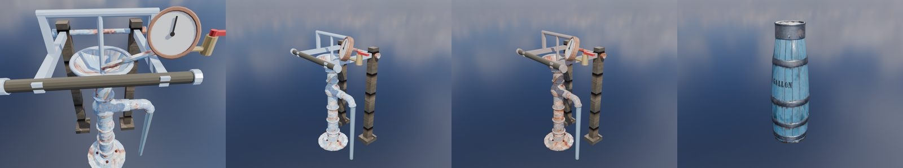

# Farm in a drought: Prime the pump (ciftlik)

A dry farmyard: a cast-iron pitcher pump on a plank platform, a jug of saved water beside it, a basin under the spout feeding an irrigation channel that runs 11 m to a wooden gate and splits left and right along a field of dead stalks. A weathered barn and an old wooden windmill (downloaded models, CC BY 4.0) over a stock tank, a fence, bare trees and dry hills all round, on baked mud cracked into plates.

- Game file: `public/v2/ciftlik/ciftlik.glb` (1.8 MB, Draco + KTX2; loading as in `art/v2/mahalle/README.md`)
- Build: `art/v2/ciftlik/build.py`
- Previews: `art/v2/ciftlik/preview/*.jpg`; numbers: `stats.json`, `pack-report.json`

Units metres, glTF Y-up, build-script north = three.js -Z. Pump at the origin, its spout toward the field (north); platform top y = 0.12.

## Budget

31,613 triangles (the barn about 5,000, the windmill 5,100), 24 draw calls; 1.8 MB in all.

## Named nodes

| Node | What | Pivot / notes |
|---|---|---|
| `pump_handle` | the iron lever with its plunger link | the fulcrum pin; rotate about local X for a stroke (grip at `pump_handle_grip`, 0.7 m toward the player) |
| `pitcher` | ceramic jug of saved water | base centre (rests at `pitcher_rest`); pour into `pump_priming_cup` |
| `pump_water_stream` | the arc of water from the spout into the basin (blended) | hide it until the pump draws |
| `basin_water` | water surface in the basin | raise it as the pump runs |
| `channel_water_main`, `channel_water_left`, `channel_water_right` | water strips on the channel bottoms (main: basin to gate; left and right: gate to the field corners) | each starts at its upstream end and runs along local -Z in three.js (+Y in Blender) for its length; scale that axis to show water advancing |
| `channel_gate` | plank gate at the split | on its post; turn it to `channel_gate_left` (sends water left) or `channel_gate_right` (right) |

## Points

| Point | Where |
|---|---|
| `seat_pump` | the stool, 1.5 m south of the pump, facing it and the channel (forward = local -Z) |
| `pump_priming_cup`, `pump_spout`, `pump_handle_grip` | the cup on top of the pump, the spout mouth, the handle's grip at rest |
| `pitcher_rest` | where the jug stands |
| `channel_gate_left`, `channel_gate_right` | the gate's two positions (rotation only) |
| `spot_farmer` | beside the platform |

## Notes for the game

- No lights in the file: a hard, high sun, a hazy warm fog (FogExp2 about 0.004, #d9cdb4) and heat shimmer suit the drought. When the field is saved, the dead stalks and soil can be tinted greener.
- Water materials (`clear_water`) are blended with alpha 0.75.

## What the game does with the file (S22, `src/v2/game/farm.ts`)

The pump in the file stands 1.2 m from the stool, out of a seated reach, so the game builds its own in code (`pump-set.ts`: a two-armed lever whose wooden bar lies across the chest, an open cup, a brass gauge) 0.58 m ahead of the eye, and hides `ciftlik_pump_iron`, `ciftlik_dark_iron`, `pump_handle`, `pump_water_stream`, `basin_water`, the three `channel_water_*` strips and `ciftlik_dry_branches_medium_01`. The eye is at (0, 1.3, 1.3). `pitcher` is moved onto a small barrel by the player's left knee; `ciftlik_watering_can_metal_01` and `ciftlik_wooden_bucket_02` are moved aside. The tub under the spout, the sluice lever, the two flumes and the two beds of six rows between the platform and the far field are made in code (`farm-yard.ts`), as is the sun's directional light.

## Rebuilding

```bash
python3 art/v2/tools/fetch_tex.py "$V2_CACHE" 1k dry_mud_field_001 farm_soil old_wood_floor brown_planks_05 box_profile_metal_sheet bark_brown_02
```

Models: `bash art/models/fetch_polyhaven.sh <id> "$V2_CACHE/<id>" 1k` for each Poly Haven id in `sources.json`. Then:

```bash
V2_CACHE=<cache> nice -n 20 blender -b --factory-startup --python art/v2/ciftlik/build.py -- /tmp/ciftlik_raw.glb --preview /tmp/prev
```

```bash
node art/v2/tools/pack.mjs /tmp/ciftlik_raw.glb public/v2/ciftlik/ciftlik.glb art/v2/ciftlik/pack-report.json
```

## The hand pump set (S21-S23): `pump_props.py`

One GLB each in `public/v2/ciftlik/`, to take the place of the shapes `pump-set.ts` builds. The pump's cast body and the jug's stand are downloaded models (CC BY 4.0, `sources.json`, `CREDITS.md`); the yoke, posts, priming cup, gauge and valve are made in `art/v2/ciftlik/pump_props.py` and wear the body's own paint, the bar and posts Poly Haven `dark_planks` (CC0).



**`yoke_pump.glb` (blue-painted cast iron, rust showing through) and `yoke_pump_rust.glb` (the same, gone brown)**, 4,226 triangles each. Same nodes in both. Laid out in pump-set.ts's frame: origin on the ground under the seated eye (eye 1.18 m up), -z ahead, spout and gauge on the right (+x); for the left side mirror the root's x.

| Node | What |
|---|---|
| `yoke_pump` / `yoke_pump_rust` | the root |
| `pump_body` | the cast body ("Old Waterpump" by Daz, its own handle, piston and handle bracket taken off): base flange on the ground, column on an axis 0.58 ahead, its top 0.78 up under the cup, the spout to the right |
| `pump_cup` | the priming cup on the body's top: an open funnel, radius 0.13, rim 0.85 up |
| `pump_posts`, `pump_pin` | two oak posts 0.40 apart, 0.28 behind the body; the iron pin 0.88 up the yoke turns on; the gauge's pipe |
| `yoke` | pivot on the pin; turn it about its local x (+28° / -30°). Two 0.47 arms toward the eye, the wooden bar (0.62 long, 0.042 across) at their ends, the piston bridge and rod over the cup. Children `yoke_iron`, `yoke_bar`, points `bar_grip_left` (x -0.2), `bar_grip_right` (x +0.2) on the bar |
| `gauge` | the copper gauge 0.16 across at (0.25, 0.99, -0.5), its face turned to the eye (the game draws its own and hides this one) |
| `valve_lever` | the relief valve's red lever beside the gauge, pivot at the valve (0.40, 0.98, -0.5); `valve_body` its brass cock |
| `pump_water_stream` | the stream from the cast spout's mouth, 0.54 long (hide it until the pump runs) |
| `pump_spout` | an empty at the cast spout's mouth: (0.27, 0.51, -0.58) (the game starts its stream there when it finds this empty) |
| `pump_priming_cup` | the middle of the cup at its rim |

| File | What | Triangles |
|---|---|---|
| `tub.glb` | a wooden tub of staves, 0.34 x 0.34 x 0.40, two iron bands, `tub_water` at 0.30; origin on the ground at its middle | 408 |
| `flume.glb` | one metre of wooden flume along -z from its origin (upstream end), open on top, `flume_water` a strip on its floor (UV 0..1 along it) | 110 |
| `keg.glb` | the jug's stand: an old staved butter churn ("Old-fashioned butter churn" by denijulie) without its dasher and handles, 0.76 tall, 0.25 across (slimmed so the bar clears it); one mesh `keg_wood`; origin on the ground at its middle | 4,550 |
| `ridge.glb` | a ridge of dry earth 0.72 wide, 3.3 long along -z from its origin, 0.18 high | 528 |
| `town.glb` | the far town of the third stage: `town_bakery` ("Western Town House 1"), `town_house` ("Wooden House Building"), `town_factory` ("small factory", its chimney to 3.6 m), each about 2.8 m wide and 2.3 m tall, front toward +z, origin on the ground at its middle, all three at the file's origin (place them by name) | 3,477 |

```bash
V2_CACHE=<cache> nice -n 20 blender -b --factory-startup --python art/v2/ciftlik/pump_props.py -- yoke_pump /tmp/yoke_pump_raw.glb --preview /tmp/prev
```

(the same for `yoke_pump_rust`, `tub`, `flume`, `keg`, `ridge`, `town`; the downloads first: `python3 art/v2/tools/sketchfab.py get <cache> <uid>` for each uid in `sources.json`), then `node art/v2/tools/pack.mjs /tmp/<name>_raw.glb public/v2/ciftlik/<name>.glb`.
