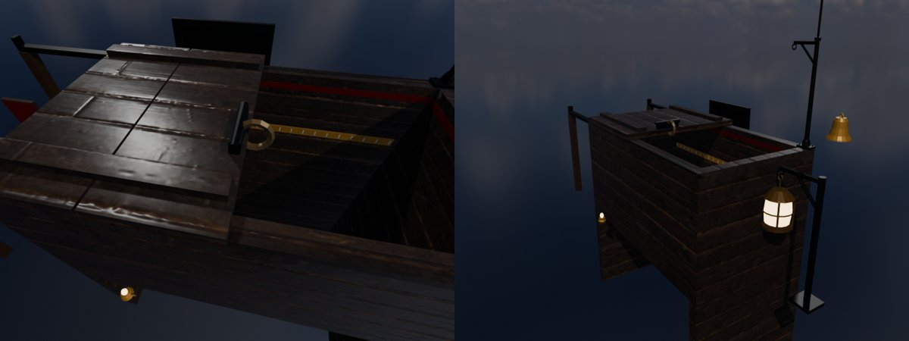
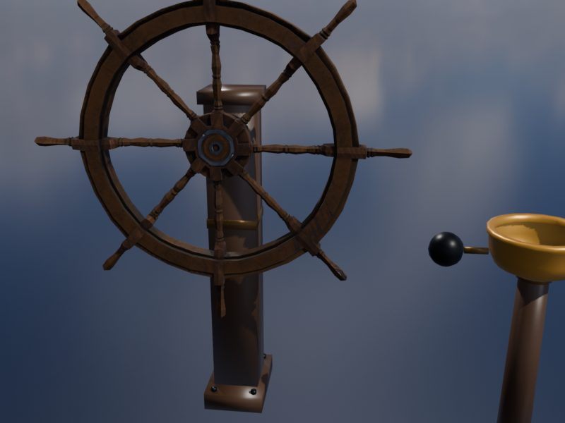

# Ship in a storm: Bail out (gemi)

The waist deck of a three-masted sailing ship in a heavy swell. The player sits on a low step aft of the capstan, facing the starboard rail: a bilge well with rising water at the left front, a bucket at the right, a sail rope to belay at the pin rail ahead, and a sweep oar through a port in the bulwark at the right front. A drum stands behind on the left for the rowing beat.

- Game file: `public/v2/gemi/gemi.glb` (1.9 MB, Draco + KTX2; loading as in `art/v2/mahalle/README.md`)
- Build: `art/v2/gemi/build.py`
- Previews: `art/v2/gemi/preview/*.jpg`; numbers: `stats.json`, `pack-report.json`

Units metres, glTF Y-up. In the file the bow points along +X, the starboard side (where the player looks) is +Z in three.js (Blender -Y), waterline y = 0, the waist deck about 1.85 m.

## Hierarchy

Two roots, so the world can move without moving the camera:

- `ship`: pivot at the waterline under the middle of the ship. Hull, rigging, the interactive parts and every point below are its children; rock and heave this node.
- `sea`: a 188 m disc with a baked swell (largest near the ship, fading outward), its own node for the game to bob, scroll or animate.

## Budget

40,300 triangles (ship 30k, sea 3.7k), 23 draw calls, 1.6 MB of textures, 1.9 MB in all.

## Named nodes (children of `ship`)

| Node | What | Pivot / notes |
|---|---|---|
| `hold_water` | water surface inside the bilge well (0.72 x 0.62 m) | its centre; move along local Y between `water_level_min` and `water_level_max`. Losing line at `water_line` (painted white stripe with notches on the far wall) |
| `bucket` | wooden bucket | bottom centre; grip at `bucket_grip` |
| `sail_rope` | the sheet from the belaying pin up to the main course's lower corner | at the pin, mesh along local +Y, rest length 6.12 m (to `sail_clew`) |
| `sail_rope_handle` | coil of the rope's free end on the deck below the pin | coil centre |
| `sails` | all sails (one mesh) | for flapping or a wind squeeze |
| `oar` | sweep oar through the port | at the oar port (rotate about it for the stroke); handle at `oar_handle` |
| `drum` | drum on legs for the stroke | floor centre |

## Points (children of `ship`)

| Point | Where |
|---|---|
| `seat_deck` | top of the step, where the seated player's floor goes; facing the starboard rail (forward = local -Z). The rail top is 0.8 m above it, so a seated player sees the sea |
| `water_level_min`, `water_line`, `water_level_max` | heights of `hold_water`: start, losing line, brim |
| `bucket_grip`, `bucket_rest` | the bucket's handle top and where it stands |
| `dump_point_1`, `dump_point_2` | rail top in front of the player, where water goes overboard |
| `sail_rope_tie`, `sail_clew` | the belaying pin (tie here) and the sail corner the rope runs to |
| `oar_handle` | the oar's grip at rest |
| `spot_drummer`, `spot_captain` | beside the drum; the quarterdeck |

## Notes for the game

- No lights and no sky in the file: a dark storm sky, a grey-blue fog (FogExp2 about 0.01) and rain sell the storm. The sea material is a dark, glossy dielectric that reflects the environment map.
- "World moves, camera doesn't": rock `ship` (roll ±6-10°, pitch ±3°, heave ±0.5 m) and bob `sea` out of phase; Less motion scales it down.
- The rigging is decimated to 13k triangles; thin lines may look broken up close.

## Rebuilding

```bash
python3 art/v2/tools/fetch_tex.py "$V2_CACHE" 1k old_wood_floor
```

Models: `bash art/models/fetch_polyhaven.sh <id> "$V2_CACHE/<id>" 1k` for each Poly Haven id in `sources.json`. Then:

```bash
V2_CACHE=<cache> nice -n 20 blender -b --factory-startup --python art/v2/gemi/build.py -- /tmp/gemi_raw.glb --preview /tmp/prev
```

```bash
node art/v2/tools/pack.mjs /tmp/gemi_raw.glb public/v2/gemi/gemi.glb art/v2/gemi/pack-report.json
```

## Hatch set for S13 (`ambar.glb`)

`public/v2/gemi/ambar.glb`: the hatch the player leans over in S13, made in `art/v2/gemi/ambar.py`. 3,472 triangles, three materials (wet old deck wood from Poly Haven `old_wood_floor`, a small painted palette for iron, brass, red paint, white and rope, warm lantern glass). Laid out in the scene's frame: the root `ambar`'s origin is the player's eye, +x right, +y up, -z ahead toward the bulwark (three.js metres).



| Node | What |
|---|---|
| `coaming` | the hatch coaming: inner opening x -0.55..0.50, z -0.20..-0.74, top edge at y -0.36, walls 0.05 thick; the near wall goes down to y -0.94, the other three to y -1.47; dark wet wood. Child `coaming_paint`: the 2 cm red stripe round the inside at y -0.40 and, on the far inner wall at y -0.58, a brass strip with a white notch every 4.5 cm |
| `cover` | the sliding cover, 0.52 x 0.03 x 0.66, two planks and two battens; origin at its own middle, closed at (-0.29, -0.345, -0.47); slide it 0.36 to the left |
| `cover_handle` | child of `cover` at (0.24, 0.055, 0.09): a horn cleat and a rope loop on the right edge |
| `runners` | the two iron rails the cover slides on (x -0.99..0.55, y -0.36, z -0.165 and -0.775) with two wooden posts at the left end down to the deck |
| `lantern_post` | an iron bracket 0.56 tall with an arm (origin at its foot, placed at (0.78, -0.94, -0.55)) |
| `lantern` | a ship's lantern, origin at the hook's hanging point, the glass 0.16 below; child of `lantern_post` here, clone it for the second one |
| `bell` | a brass ship's bell, origin at the ring on top, 0.11 tall |
| `gauge` | the float gauge board, 0.11 x 0.46 facing the player, top 22 % red, bottom 14 % brass, ticks between; origin at its middle |
| `gauge_pointer` | child of `gauge`: a 9 cm brass arrow pointing left (-x) at the board, origin at its tip |
| `step_lamp` | a 5 cm brass oil lamp with a glowing chimney, origin at its foot (clone for three) |
| `bell_post` | an iron bracket for the bell standing on the coaming's far wall: foot plate with four bolts, origin at its foot (0.52, -0.36, -0.765), 0.46 tall, an arm 0.12 to -x at the top with a brace under it and a shackle at the end (0.40, 0.07, -0.765) for the bell |
| `feather_hook` | a thin iron rising 0.23 from the post's top (origin there, (0.52, 0.10, -0.765)), turned over in a small crook (about 7 cm of iron) toward -x, and a 6 cm cord with a knot from its end. Child `feather_hook_end`: the cord's end, (0.47, 0.262, -0.765), where the feather hangs |
| `wash_port` | the wash port in the bulwark, origin at its middle (-0.20, -0.36, -0.915), facing the player: a riveted iron frame (2.8 cm wide, 1.4 cm proud, the sill a little more) round a 0.32 x 0.12 opening. `wash_port_hole` is the opening, a dark plate 1-4 mm in front of the bulwark's face; hide it if the bulwark itself is cut open there |

```bash
V2_CACHE=<cache> nice -n 20 blender -b --factory-startup --python art/v2/gemi/ambar.py -- /tmp/ambar_raw.glb --preview /tmp/prev
```

```bash
node art/v2/tools/pack.mjs /tmp/ambar_raw.glb public/v2/gemi/ambar.glb
```

## Ship's wheel for the storm's second stage (`dumen.glb`)

`public/v2/gemi/dumen.glb`, made in `art/v2/gemi/dumen.py`: the wheel is a downloaded wooden wheel ("Ship Wheel 4k Textured" by MarkusHenkel, CC BY 4.0, `sources.json`) with its own wood maps, scaled so its rim's middle line has the radius the game grips (0.27, handle tips at 0.35); the pedestal and binnacle are made here in the hatch set's wood and brass. 5,321 triangles, 0.45 MB. Metres, +y up.



| Node | What |
|---|---|
| `dumen` | the root |
| `wheel` | the turning part: origin at the hub's middle, turning about local z, +z toward the helmsman. The downloaded wooden wheel: rim middle line radius 0.27, eight turned spokes running out through it to handles (tips at 0.35), one straight up (+y) |
| `pedestal` | fixed: origin at the hub's middle; a wooden column behind the wheel (z -0.11..-0.21) down 0.62 to the deck on a bolted plinth, an iron bearing and the axle's stub to the hub |
| `binnacle` | origin at the middle of the card: a brass bowl 0.16 across with an open face (the game draws the card), on a wooden post 0.5 down to a brass foot, two iron correcting balls on arms; placed to the helmsman's right at (0.56, -0.12, 0.08) |

```bash
V2_CACHE=<cache> nice -n 20 blender -b --factory-startup --python art/v2/gemi/dumen.py -- /tmp/dumen_raw.glb --preview /tmp/prev
```

```bash
node art/v2/tools/pack.mjs /tmp/dumen_raw.glb public/v2/gemi/dumen.glb
```
