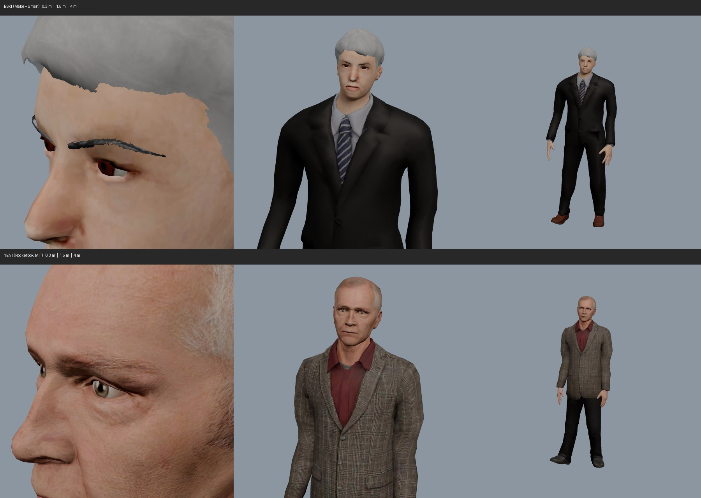

# People (insan)

Realistic, rigged and animated people for v2, one GLB each in `public/v2/insan/`. Since 18 Nov 06:00 they are photo-textured avatars from the Microsoft Rocketbox library (MIT licence, `LICENSE-rocketbox.txt`), put on the same skeleton, names and clips as before by `rocketbox.py` (see "Rocketbox" below); the earlier MakeHuman people (CC0, `build.py`) are in the git history. Motions are real motion capture from the CMU database, retargeted onto MakeHuman's `cmu_mb` skeleton (`art/v2/insan/motion.py`, see "How the motion is put on") and checked frame by frame: a build stops if any frame breaks the pose rules below. No logos: garments that carry the MakeHuman logo are not used.

| File | Who | Rocketbox avatar | Triangles | Draw calls | Size |
|---|---|---|---|---|---|
| `gray.glb` | Prime Minister Gray, 50s: grey hair, tweed jacket | `Male_Adult_03` | 7,200 | 3 | 1.73 MB |
| `maya.glb` | Maya Brooks, persona: dark trouser suit | `Business_Female_01` | 8,966 | 3 | 1.91 MB |
| `leo.glb` | Leo Carter, persona: light blue shirt and jeans | `Male_Adult_08` | 7,364 | 3 | 1.66 MB |
| `sam.glb` | Sam Reed, persona: work overalls, hard hat, tool belt | `Construction_Male_04` | 9,988 | 4 | 1.60 MB |
| `walt.glb` | Walt Webb, memory keeper (Safety net): grey stubble, field vest | `Male_Adult_05` | 7,836 | 3 | 1.78 MB |
| `june.glb` | June Parker, memory keeper (Firewall): brown jacket | `Female_Adult_09` | 9,032 | 3 | 1.74 MB |
| `ben.glb` | Ben Marsh, memory keeper (Bail out): grey beard, work jacket, yellow boots | `Gardener_Male_01` | 7,470 | 3 | 1.75 MB |
| `helen.glb` | Helen Stone, memory keeper (Stress test): glasses, red jacket | `Business_Female_02` | 8,640 | 4 | 1.96 MB |
| `edna.glb` | Edna Wells, memory keeper (Prime the pump): sweater, denim skirt | `Female_Adult_02` | 8,940 | 3 | 1.88 MB |
| `george.glb` | George Penn, memory keeper (Ring-fence): guard uniform and cap | `Security_Male_01` | 9,515 | 3 | 1.83 MB |
| `crowd_man_suit.glb` | Crowd: man in a dark suit | `Business_Male_03` | 7,810 | 3 | 1.43 MB |
| `crowd_man_casual.glb` | Crowd: man in a grey jacket and jeans | `Male_Adult_07` | 7,588 | 3 | 1.29 MB |
| `crowd_woman_a.glb` | Crowd: woman in a leather jacket | `Female_Adult_04` | 9,284 | 3 | 1.43 MB |
| `crowd_woman_b.glb` | Crowd: woman in a pinstripe trouser suit | `Business_Female_04` | 8,270 | 3 | 1.29 MB |
| `acrobat_partner.glb` | Circus: a flyer beside the player, maroon sequinned suit, gold trim and cuffs, cream tights, red slippers (`costumes.json`) | `Sports_Male_01` | 7,358 | 2 | 1.77 MB |
| `acrobat_woman.glb` | Circus: high-wire walker, green sequinned leotard with gold trim, bare legs, pale slippers | `Sports_Female_01` | 8,480 | 2 | 1.27 MB |
| `elder.glb` | The herd's elder (valley, Ring-fence): an old man with a grey beard, a fur hood, a long hide coat and fur boots, 1.70 m (`costumes.json` `elder`) | `Male_Adult_19` | 6,732 | 3 | 0.88 MB |

All seventeen share the same skeleton and the same five clips. Eight on screen at once come to about 70k triangles and 25 draw calls. For a larger crowd, clone the four crowd files (`SkeletonUtils.clone`) and vary them in the game: start each clip at a random time, scale by 0.95-1.05, and mirror some (`scale.x = -1`).

Previews: `art/v2/insan/preview/<name>.jpg` (idle, walk, talk, point, cheer). Per-character numbers: `art/v2/insan/stats/<name>.json`.

Hand props from the design (Edna's pitcher, Helen's coiled rope, George's keyring, Walt's chalked hands) are not modelled on the people. The pitcher is in the farm scene (`pitcher`); attach props to the `LeftHand` / `RightHand` bones in the game. The memory keepers are old people, but the clips are the same adult motions; slow `walk` with `timeScale` 0.8 and move them at about 1.3 m/s if they should look older.

## In each GLB

- One armature (the node named after the character) with 31 bones, CMU names: `Hips`, `LHipJoint`, `LeftUpLeg`, `LeftLeg`, `LeftFoot`, `LeftToeBase`, `RHipJoint`, `RightUpLeg`, `RightLeg`, `RightFoot`, `RightToeBase`, `LowerBack`, `Spine`, `Spine1`, `Neck`, `Neck1`, `Head`, `LeftShoulder`, `LeftArm`, `LeftForeArm`, `LeftHand`, `LeftFingerBase`, `LeftHandFinger1`, `LThumb` and the same on the right.
- Photo-textured faces with real eyes and brows; no hair covers the forehead or an eye; the crowd wear jackets and suits (no bare skin) for the rainy 2008 bank queue.
- Three skinned meshes: `<name>_skin` (the head, photo texture 2048 for the named people and 1024 for the crowd, with its normal map), `<name>_outfit` (body and clothes, 1024; hard hats, tool belts and guard kit as extra materials at 512), `<name>_hair` (hair, lashes and glasses, alpha-cut: glTF `alphaMode` MASK, `alphaCutoff` 0.5, so three.js sets `alphaTest` 0.5 and nothing needs sorting). Draco geometry, KTX2 textures.
- Origin at the feet, facing +Z (three.js forward toward a default camera), 1.65-1.85 m tall, metres.
- Five animation clips, all in place (the hips stay over the origin; the game moves the node):

| Clip | Source (CMU) | Length | Loops |
|---|---|---|---|
| `idle` | 77_02 "standing": arms hanging, small shifts of weight | 6.0 s | yes |
| `walk` | 08_01 "walk", one stride | 1.0 s | yes; move the node at 1.59 m/s to keep the feet from sliding |
| `talk` | 18_08 "conversation, explain with hand gestures" | 6.0 s | yes |
| `point` | 13_27 "direct traffic, wave, point": a wave, then an arm reaching out | 2.2 s | no (play once, then back to idle) |
| `cheer` | 79_69 "very happy": both arms up in a V, then hands on the hips | 2.5 s | no |

Hands and fingers keep MakeHuman's relaxed rest relative to the forearm (CMU's hand data is coarse). The head keeps its motion relative to the chest minus the clip's average turn, so nobody looks at the floor for a whole clip (the standing performer looked 35 degrees down).

## Faces (MakeHuman people, before Rocketbox)

Checked in three.js from 2.5 m (a headset's 20 pixels per degree): `art/v2/insan/preview/face_<name>.jpg` (front, three-quarter, and a zoomed check).
- The head's part of the skin picture gets its detail lifted (an unsharp mask of about 8 px on the 1024 picture) and its darker features darkened a little: brows painted in the skin, lids, nostrils, lips.
- Eyebrow pictures are darker and a pixel thicker; for grey- and white-haired people a clear mid grey instead (never black).
- The eyes get four times the size in the outfit atlas (sixteen times the pixels); small eyes in the atlas were the blurred "eye area".
- Hair: no fringe over the forehead or an eye (`crowd_woman_a` and Edna tie theirs back, June and Ben wear theirs short, Sam's is swept back).

## How the motion is put on (motion.py)

1. The target is first put into the source's rest pose (the BVH T-pose) by forward kinematics, parents first: each bone follows its parent rigidly, then a limb bone swings onto the source's rest direction. So the forearm's twist stays tied to the upper arm's.
2. Every source bone's world turn from its rest, `D(t) = S(t) · S_rest⁻¹`, is applied to that reference: `W(t) = D(t) · T_ref`; each bone's local rotation is then `W_parent⁻¹ · W` in the bones' rest frames.
3. The clavicles (`LeftShoulder`, `RightShoulder`) and the hip joints take no motion: they stay in their rest pose on `Spine1` and `Hips`, so the shoulders keep their width.
4. Elbows and knees are hinges: the bend angle is the source's, limited to 0-150 degrees, and it happens only about the hinge axis that MakeHuman's own rest bend defines; the upper arm is turned about its own length so its hinge plane holds the source's forearm (elbow and wrist stay where the source puts them). Forearm twist follows the source within ±60 degrees.
5. Body size: the CMU performers are slimmer (and some taller) than these people, so each arm is turned outward about the chest's forward axis, by the least angle that keeps the elbow 19 cm from the trunk's axis, the wrist outside the trunk and every point of the hand 13.5 cm from the face (smoothed over time; at most 12.5 degrees, 18.5 in one clip of the shortest woman).
6. The shoulders' skin weights are smoothed (30 passes over the vertices within 22 cm of each shoulder joint, not toward the chest), so an arm coming down from MakeHuman's A-pose rounds the shoulder instead of leaving a square pad with a notch under it.

## Pose rules, checked on every frame of every clip

`motion.check` plays each clip in Blender and measures every frame; if one rule fails the build stops and exports nothing (`--warn-only` exports anyway, for looking into a failure):

- the shoulder joints (heads of `LeftArm`, `RightArm`) stay at least 97 % of their rest distance apart;
- each elbow stays at least 18 cm from the trunk's axis (`Hips` head to `Neck` head);
- each elbow bends 0-150 degrees and no more than 15 degrees out of its hinge plane;
- neither wrist goes inside the trunk (85 % of the measured cross-section of `Hips`, `LowerBack`, `Spine`, `Spine1`, skin and clothes together);
- no point of a hand (wrist, knuckles, fingertip) comes within 12 cm of the face, unless the clip is marked `face_ok` in `clips.json` (none is).

The smallest and largest values per clip are in `stats/<name>.json` under `check`. In all fourteen Rocketbox people (every frame of every clip): shoulders 100 % of rest width, elbows at least 19 cm from the axis, elbow bends 7-113 degrees, at most 1.7 degrees off the hinge, no wrist in the trunk, hands at least 20.9 cm from the face; the arm correction turns an arm out by at most 16.5 degrees.

## Use in the game

```ts
const gltf = AssetManager.getGLTF('gray');           // or GLTFLoader
const mixer = new AnimationMixer(gltf.scene);
const idle = mixer.clipAction(AnimationClip.findByName(gltf.animations, 'idle'));
idle.play();
// one-shots: action.setLoop(LoopOnce, 1); action.clampWhenFinished = true; crossfade back to idle
```

Several characters can share one file through `SkeletonUtils.clone` (IWSDK's `AssetManager.getGLTF` already returns clones).

## Matching the Quaternius characters the code uses now

| Here | Quaternius (Ultimate Animated Character Pack) |
|---|---|
| `idle` | `Idle` |
| `walk` | `Walk` |
| `talk` | none (use `Idle`) |
| `point` | `Wave` is the closest |
| `cheer` | `Wave` / `Yes` |

The skeletons differ (CMU names here, Quaternius names there), so clips do not transfer between the two sets; each character here carries its own five clips.

## Rebuilding

MPFB 2.0.18 (https://github.com/makehumancommunity/mpfb2, `src/mpfb` zipped as a Blender extension) and the CC0 system assets (https://files.makehumancommunity.org/asset_packs/makehuman_system_assets/makehuman_system_assets_cc0.zip) are installed into a separate Blender resources folder, so the everyday Blender setup is not touched:

```bash
BLENDER_USER_RESOURCES=<dir> blender -b --factory-startup --command extension install-file -r user_default -e mpfb_ext.zip
```

Unzip the asset pack into `<dir>/extensions/.user/user_default/mpfb/data/`. The CMU BVH files come from https://github.com/una-dinosauria/cmu-mocap (`data/<subject>/<clip>.bvh`) into `$V2_CACHE/cmu/`. Then, per person in `characters.json`:

```bash
BLENDER_USER_RESOURCES=<dir> V2_CACHE=<cache> nice -n 20 blender -b --python art/v2/insan/build.py -- gray /tmp/gray_raw.glb --preview /tmp/prev
```

```bash
node art/v2/tools/pack.mjs /tmp/gray_raw.glb public/v2/insan/gray.glb
```

Notes on the build: MPFB's own "feet on ground" step, run headless, lifts only some bones, so the build makes the person in MakeHuman's coordinates and lifts skeleton and meshes together. Frame 1 of every Hahne BVH is a T-pose, not motion; the clip picker starts after it. The CMU files used are 08_01, 13_27, 18_08, 77_02 and 79_69.

## Rocketbox (how the photo-textured people are made)

`gray.glb` (also kept as `deneme/gray.glb`, the first trial) was the first person made from the Microsoft Rocketbox avatar library (github.com/microsoft/Microsoft-Rocketbox, MIT licence, copy in `LICENSE-rocketbox.txt`): avatar `Male_Adult_03`, photo-textured head (2048) and clothes (1024), 7,200 triangles, 3 draw calls, 1.73 MB. Same armature name, the same 31 bone names, mesh names (`gray_skin`, `gray_outfit`, `gray_hair`) and five clips as `gray.glb`, so it can take its place without code changes; every frame passes the same pose check.



`art/v2/insan/rocketbox.py` does it: the FBX's transforms are baked into the data (the Biped bones are freed from each other first, so no joint moves twice; the FBX take that keys the old unit scale is dropped), Biped bones are renamed to the CMU names, the rest of the fingers, toes, twist and face bones give their weights to the nearest kept bone above them, the clavicles are hung on `Spine1`, and `LHipJoint`, `RHipJoint`, `Neck1` are added with no weight. `motion.py` now takes a limb bone's direction from joint to joint (Rocketbox feet point level at the ankle), the facing from ankle to the ball of the foot, and, for a straight rest limb, bends elbows forward and knees back.

The avatar's files come from the repository's raw files: `Assets/Avatars/<group>/<avatar>/Export/<avatar>.fbx` and everything in `.../Textures/` (no account needed).

```bash
V2_CACHE=<cache> nice -n 20 blender -b --python art/v2/insan/rocketbox.py -- <cache>/rocketbox/Male_Adult_03/Export/Male_Adult_03.fbx <cache>/rocketbox/Male_Adult_03/Textures gray /tmp/gray_raw.glb --head 2048 --preview /tmp/prev
```

```bash
node art/v2/tools/pack.mjs /tmp/gray_raw.glb public/v2/insan/deneme/gray.glb
```

### Circus costumes (costume.py)

`acrobat_partner` and `acrobat_woman` (and the trapeze catcher, `art/v2/sirk/pose.py`) wear circus costumes painted into the avatar's own body picture, so the body stays one material and the cloth keeps the photo's light and shade. `costume.py` decides every pixel's region from the skin weights interpolated across its triangle (borders are smooth curves, not triangle teeth): suit on the trunk (sequinned: small brighter discs scattered on it, gold trim where it meets another region), satin sleeves on the arms, tights on the legs, slippers on the feet, gold cuffs and chalked hands by distance up the forearm. The shading comes from a blur of the photo's brightness with the photo's own clothes left out (pink, blue, white or grey cloth); where the body stays bare, leftover clothes (a bikini's straps) are covered with the skin round them, and the painted islands are grown into the texture's padding so no skin bleeds in at a distance. For the elder the head cloth's own picture becomes fur (`fur_parts`, keeping its folds), the robe a hide coat and the beard grey (`grey_beard`: the dark hair of the lower face in the head picture); `--height` scales a person to a height. The costumes are in `costumes.json`; the flyers wear the player's colours (`circus-body.ts` `PLAYER_LOOK`), the high-wire walkers a green leotard with bare legs.

Rocketbox has one man in fitted clothes (`Sports_Male_01`, swim trunks); loose shirts and shorts show through the paint (a `Sports_Male_04` trial looked like a football kit), so the partner and the catcher share that body, in different colours.

```bash
V2_CACHE=<cache> nice -n 20 blender -b --python art/v2/insan/rocketbox.py -- <cache>/rocketbox/Sports_Male_01/Export/Sports_Male_01.fbx <cache>/rocketbox/Sports_Male_01/Textures acrobat_partner /tmp/acrobat_partner_raw.glb --head 1024 --costume acrobat_partner --body-normal --preview /tmp/prev
```
