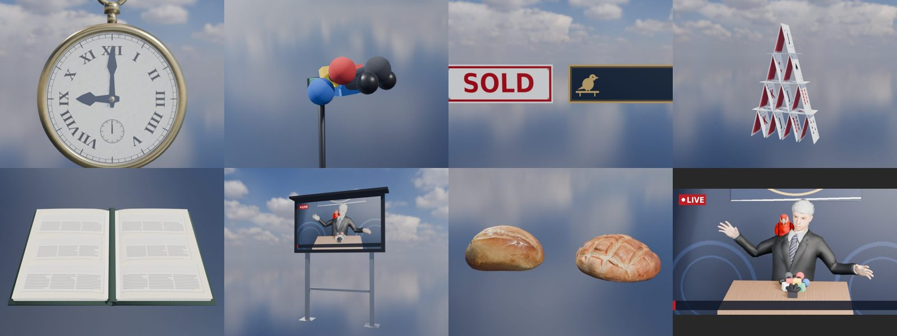
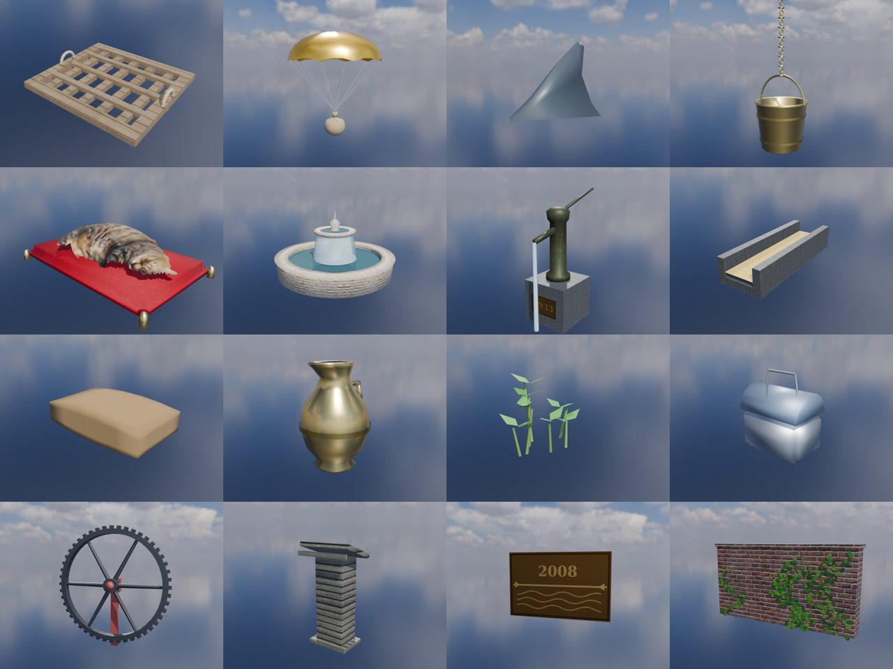
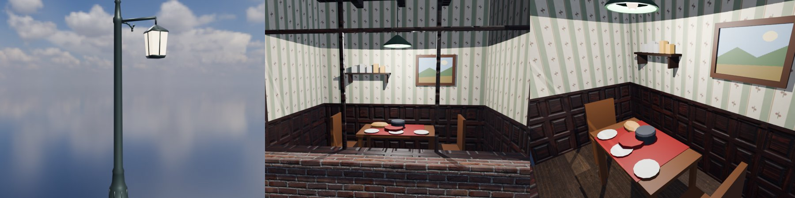
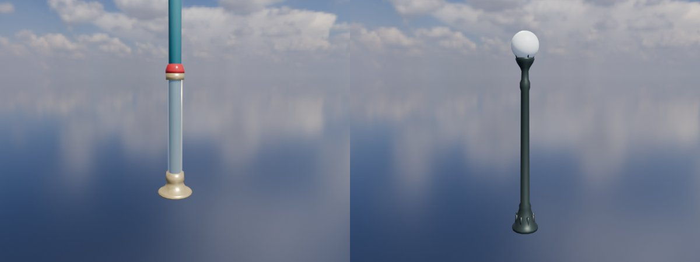

# Small props (nesne)

The small things the scene cards ask for (S01–S16, S21–S23, S28–S31), one GLB each in `public/v2/nesne/`, 1.7 MB in all (two sets). Draco geometry, KTX2 textures. Each one is meant to take the place of the stand-in the game code builds today (named in the last column); the game's own logic stays as it is.



| File | What | Triangles | Size | Replaces in the code |
|---|---|---|---|---|
| `pocket_watch.glb` | gold pocket watch stopped at 09:00 (S04, S28, S29) | 2,144 | 65 KB | `PocketWatch` group and `WatchHand` in `opening.ts` |
| `microphones.glb` | five press microphones with plain coloured flags, and a slim stand | 1,940 | 19 KB | `Microphones` group in `setUpCity` |
| `signs.glb` | `sign_sold` and a company plate with a field for the name (S02, S29) | 26 | 46 KB | `makeSign` boards |
| `card_bank.glb` | a house of 26 playing cards, 1.8 m tall (S08) | 312 standing | 72 KB | (new) |
| `clipping_book.glb` | the mother's clippings book, open (S05 on) | 408 | 74 KB | `Paper` used as the notebook |
| `broadcast_screen.glb` | outdoor screen on two legs, showing the prime minister with the parrot on his shoulder, LIVE (S01, S05) | 86 | 66 KB | `BroadcastScreen` plane |
| `loaves.glb` | a long loaf and a round loaf (S01) | 2,157 | 453 KB | the stretched spheres in `Falls` |
| `broadcast_live.jpg` | the screen's picture on its own, 1024 × 576 | | 57 KB | the canvas in `broadcastScreen()` |

Everything faces +Z (toward a default three.js camera), metres, Y up.

## Nodes

**pocket_watch.glb** (case 0.125 m across, the size the code uses; a real one is about half: scale 0.5 for that)
- `pocket_watch`: the root, at the centre of the dial.
- `hour_hand`, `minute_hand`: pivot at the dial centre. At rotation 0 they point to twelve; a positive turn about local Z is counter-clockwise as seen from the front. `hour_hand` is stored at +π/2 (nine o'clock), `minute_hand` at 0, so the file shows 09:00. The code's swing (`rotation.z = π/2`, one turn back) works on `hour_hand` as it is.
- `seconds_hand` (in the small dial at six), `hub` (cap, child of `minute_hand`), `dial`, `case`, `bow`, `glass` (12 % opaque; hide it if it sorts badly).
- `chain_ring`: point at the top of the bow, for a chain or the hand that holds it.

**microphones.glb**
- `microphones`: the root, where the handles meet in the clamp. The heads point along -Z (away from a default camera, toward the speaker standing in front of them) and tilt up 13–24°.
- `mic_black`, `mic_grille`, `mic_foam0..2`, `mic_flag0..4`: the parts, merged by material (11 draw calls; merge further if needed).
- `mic_stand`: a 1.2 m stand with three feet below the root. Hide it when the bundle sits on a podium or is held.

**signs.glb** (each board 1.4 × 0.5 m like the code's, origin at the back face centre, front toward +Z)
- `sign_sold`: white enamel plate, red SOLD.
- `sign_company`: navy plate with a brass border and a brass bird-on-a-perch mark; the right part is plain.
- `sign_company_lettering`: a plane over that plain part (UV 0..1, transparent until the game draws on it): put the company name there with a canvas texture, as `makeSign` does now.
- **The name is not in the file.** "Roost Holdings" is also the name of a real company (Roost Holdings Inc., a home-care operator in the US and Europe), so it was left out under the no-real-brands rule. The game can draw any name into the lettering field.

**card_bank.glb**
- `card_bank`: the root, on the ground under the middle of the house.
- `card_bank_standing`: the whole house as one mesh (1 draw call) for while it stands.
- `cards` → `card_01` … `card_26`: every card on its own, each with its origin at its centre, for the collapse. Show either `card_bank_standing` or `cards`, not both (they are in the same place). Rows of 4, 3, 2 and 1 leaning pairs with floor cards between; the faces look outward, the red backs inward.

**clipping_book.glb** (open, 0.51 × 0.34 m)
- `clipping_book`: the root, at the bottom of the spine.
- `page_left`, `page_right`: the two pages, each with its own UV 0..1 over the page (u from the spine outward on the right page, from the outer edge to the spine on the left), so a canvas with the headlines can go straight onto either. The default picture is three pasted clippings with an empty headline strip at the top of each.
- `book_cover` (green cloth), `page_block` (the edges).

**broadcast_screen.glb**
- `broadcast_screen`: the root, on the ground between the legs.
- `screen`: the picture, 3.2 × 1.8 m (16:9, UV 0..1), self-lit; its centre is the node `screen_centre`, 3.6 m up (the code's height). Swap its texture for a live one if wanted.
- `screen_frame` (black box and rain hood), `screen_legs` (steel).

**loaves.glb**
- `loaf_long` (0.23 × 0.12 × 0.15 m) and `loaf_round` (0.24 across, 0.10 high), origins at their bases, 0.32 m apart. One mesh and one material each, so each works as the geometry of an `InstancedMesh` for the falling bread.

## Second set: the ship, the drought, the end (S12–S16, S21–S23, S28–S31)

Things the cards ask for that no scene had yet. 0.9 MB more; every file is one small GLB in `public/v2/nesne/`.



| File | Scene | Triangles | What and nodes |
|---|---|---|---|
| `hatch_cover.glb` | S13 | 528 | The lid of the ship's well: a wooden grating, 0.92 × 0.82 m, rope handles at both ends. Origin at its bottom centre. **In place** it sits on the well's coaming: in the ship's frame (`ship` node of `gemi.glb`, three.js) at x -3.7, y 2.32, z 0.6, no turn. |
| `golden_parachute.glb` | S12, S15 | 742 | A gold canopy (1.15 m radius) with ten cords and a money bag; 2.6 m tall. Origin under the bag. `canopy`, `cords`, `money_bag`. Use it three times; for the clawback, pull them back up. |
| `shark_fin.glb` | S12 | 40 | A dark dorsal fin, 0.45 m tall, origin on the waterline, leading edge toward +Z. Circle a few in the flooded street. |
| `giant_bucket.glb` | S15 | 5,296 | The giant gold bucket (1 m tall) and its chain. `bucket` (origin at the bottom), `handle`, `chain` (3 m of links hanging from the handle top; its origin is at the handle, so scale it along Y to shorten it), `chain_top`. |
| `fat_cat.glb` | S15 | 2,518 | A fat cat asleep on a red velvet cushion with gold tassels (0.55 m long), for the bank balcony. `cat`, `cushion`, `cushion_tassels`. Origin on the floor under the cushion. Static (the purr is a sound). |
| `fountain.glb` | S05, S12, S21 | 1,832 | The square's fountain: stone basin 3.3 m across with a column and bowl. `fountain_water` (basin surface, 0.36 m up), `bowl_water` (bowl surface), `jet` (the falling water, see-through). For the dry fountain (S21) hide all three. |
| `old_pump.glb` | S21–S23, S29 | 418 | The rusty old pump on a stone base with a brass 1933 plaque. `pump_handle` (pivot at the top of the pump; turns about local X), `pump_water_stream` (hide it until the pump runs), `plaque`; points `pump_spout`, `pump_priming_cup` (where the treasury jug pours), `pump_handle_grip`. |
| `stone_trough.glb` | S23 | 38 | One metre of stone channel to lay end to end (along -Z from its origin at the upstream end). `trough_water`: a gold-water strip on its bottom; scale it along its length to show the water arriving. |
| `sandbag.glb` | S23 | 300 | One sandbag (0.6 × 0.35 m), for an `InstancedMesh`. |
| `treasury_jug.glb` | S23 | 1,152 | The treasury's gold jug, 0.63 m tall. Points `jug_spout`, `jug_grip`. |
| `sprouts.glb` | S23, S29 | 98 | A clump of seven green sprouts (0.12 m), to scatter between the cobbles (instanced). |
| `lunch_pail.glb` | S21 | 156 | A metal lunch pail for the seated workers. |
| `factory_wheel.glb` | S21, S23 | 1,288 | A 2.4 m flywheel with a red bracket, for the factory wall. `wheel` turns about its axle (local Z in three.js); still in S21, turning in S23. Origin at the axle. |
| `lectern.glb` | S21, S28 | 48 | An outdoor lectern for the square (empty in S21, Gray at it in S28). The front faces +Z; `speaker` is where he stands, `lectern_top` the desk. |
| `water_line_plaque.glb` | S29 | 12 | A bronze plaque, 0.44 × 0.28 m, with the 2008 water line across it and waves under it. Origin at the back (on the wall); `water_line` is the line's height. |
| `ivy_wall.glb` | S29 | 1,628 | What is left of the firewall in 2041: a 3 m brick wall, 1.5 m high, with ivy. |
| `net_inlay.png` | S29 | | A brass net set into the paving: lines only, transparent between (1024 px, tiles). Put it on a plane just above the cobbles with `alphaTest`. |

Not found under CC0 or CC BY: a sparrow (S04, S30); the old man's birds are not in this set.

## Not made

- The savings jars: they belong to the ice-age-valley problem (S24–S27), which is out of scope.
- Hand props for the memory keepers (Edna's pitcher is the farm scene's `pitcher`).

## Rebuilding

```bash
python3 art/v2/nesne/textures.py /tmp/nesne_tex
```

```bash
nice -n 20 blender -b --factory-startup --python art/v2/tools/prep_model.py -- --in $V2_CACHE/sketchfab/daf4801f72ae4f9eba9c338afbbb2926.glb --out /tmp/nesne_tex/loaf_raw.glb --name loaf_long --tris 958 --tex 512 --height 0.12
```

```bash
nice -n 20 blender -b --factory-startup --python art/v2/tools/prep_model.py -- --in $V2_CACHE/sketchfab/3aa235f727a6456b8170e06a2138798c.glb --out /tmp/nesne_tex/roll_raw.glb --name loaf_round --tris 1200 --tex 512 --height 0.1
```

The screen picture needs the unpacked press room, Gray and parrot builds (see their READMEs) and the microphones:

```bash
nice -n 20 blender -b --factory-startup --python art/v2/nesne/live_picture.py -- ofis_raw.glb gray_raw.glb parrot_built.glb microphones_raw.glb /tmp/live.png 55 1024
```

```bash
python3 art/v2/nesne/live_bug.py /tmp/live.png /tmp/nesne_tex/broadcast_live.jpg
```

Then, for each prop (`pocket_watch`, `microphones`, `signs`, `card_bank`, `clipping_book`, `broadcast_screen`, `loaves`):

```bash
nice -n 20 blender -b --factory-startup --python art/v2/nesne/build.py -- pocket_watch /tmp/pocket_watch_raw.glb /tmp/nesne_tex --preview /tmp/prev
```

```bash
node art/v2/tools/pack.mjs /tmp/pocket_watch_raw.glb public/v2/nesne/pocket_watch.glb
```

## Last scenes: street lamp and family room (S11, S16, S30-S31)

Made in `art/v2/nesne/final_props.py` (pictures from `room_textures.py`; Poly Haven CC0 textures `dark_paneled_wood`, `old_wood_floor`, `red_brick_03`).



**`street_lamp.glb`**, 892 triangles, 2 materials: a 2.7 m cast-iron street lamp of the 1930s, fluted base, a scrolled arm 0.5 m to the side (+x) with one square lantern.
- `street_lamp`: the root, under the foot.
- `lamp_glass`: the lantern's glass, its own warm emissive material (set the light's strength with it).

**`family_room.glb`**, 1,362 triangles, 6 materials (wallpaper, panelled wood, floor, brick, the room's things, the lamp's bulb): a family room in a bay, inside 3.0 wide, 2.85 high, 1.7 deep, the front open toward +z (the game puts the glass there). Striped wallpaper over dark panelling, a wooden floor, a 1.1 x 0.6 table (top 0.74) with a red cloth, bread, a pot and three plates, two chairs, a shelf and a landscape picture on the back wall, a pendant lamp; outside, brick below the sill (0.75) and round the bay, and the window's frame and mullions.
- `family_room`: the root, on the floor at the room's middle.
- `room_glass_centre`: the middle of the window opening, where the glass goes.
- `pendant_bulb`: the lamp's bulb (`room_lamp_bulb` is its glowing mesh).

## The bank: flood glass and round lamps (S15-S16)

Also made in `art/v2/nesne/final_props.py`.



**`flood_glass.glb`**, 936 triangles, 5 materials: a glass tube 0.30 m tall and 4.4 cm across on a brass foot, brass collar and a red enamel cap with a small knob on top, a flat brass back stay with a white scale (on the -z side, read from +z through the glass).
- `flood_glass`: the root, at the tube's bottom (inside); the foot goes 5 cm below it.
- `flood_glass_tube`: the glass (clear, alpha 0.2, BLEND).
- `flood_glass_water`: a unit water column 1 m tall and 1.8 cm in radius, origin at its bottom; scale its y to the water's height (0.30 fills the tube).
- `flood_glass_fittings`: brass, enamel and the scale.

**`round_lamp.glb`**, 1,216 triangles, 2 materials: a small cast-iron lamp post 1.1 m tall (fluted bell base, slim shaft, collar, a cup with four claws) with a 17 cm frosted glass globe on top (globe centre 1.17 m, top 1.26 m).
- `round_lamp`: the root, at the post's foot.
- `round_lamp_glass`: the globe, its own material (`round_lamp_frost`, not lit; give it emissive to light it).
- `round_lamp_iron`: the post.
