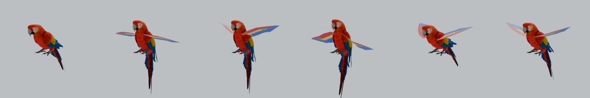
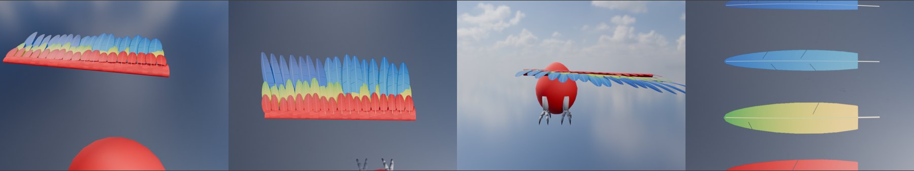

# Parrot (papagan)

One perched macaw that can fly, land and spread its wings: `public/v2/papagan/parrot.glb`, 0.28 MB, 6,083 triangles, 3 draw calls (body and two open wings), one 1024 body texture and one wing picture, Draco and KTX2. For the broadcast screen (the parrot on the leader's shoulder, the player's mirror), S30 (the old man tips his hat to it) and anywhere the bird is seen whole.



## Nodes

| Node | What |
|---|---|
| `parrot_root` | The node to place. Origin where the claws grip, so it can sit on a shoulder, a perch or `spot_parrot_*` in the scenes. Looks along +Z (three.js), like the people. |
| `parrot` | The armature: `root`, `body`, `head`, `tail`, `wing_L`, `wing_L_outer`, `wing_R`, `wing_R_outer`. |
| `parrot_body` | The bird with its folded wings (skinned). In the earlier static file this mesh was called `parrot`. |
| `parrot_wing_L`, `parrot_wing_R` | The open wings (skinned, double-sided, red, yellow and blue). They grow out of the shoulders when the wings open and shrink to nothing when they fold. |
| `perch_grip` | Same as the origin: the point to put on the perch or shoulder. |
| `head_top` | Top of the head, 0.36 m above the grip, 0.21 m forward. |
| `beak_tip` | Tip of the beak, 0.26 m forward of the grip. |
| `tail_tip` | End of the tail, 0.45 m below and 0.5 m behind the grip. |

Size: 0.80 m from tail tip to head top, 0.75 m long. Scale `parrot_root` in the game if the bird should look smaller.

## Clips

All in place; the game moves `parrot_root` (for a landing, carry it from the air to the perch during the first 0.75 s of `land`).

| Clip | Length | Loops | What |
|---|---|---|---|
| `idle` | 4 s | yes | Perched: turns and tilts its head, flicks its tail, breathes. Wings folded. |
| `flap` | 1 s | yes | Flying or hovering: wings open, three beats a second, body up. |
| `land` | 1.5 s | no | Arrives with wings spread and body up to brake, two beats, touches down at 0.75 s, folds its wings by 1.15 s, bobs and settles. Then cross-fade to `idle`. |
| `wings_open` | 1 s | no | Spreads both wings and holds them open (play once with `clampWhenFinished`; play it backwards, `timeScale = -1`, to fold them again). |

```ts
const gltf = AssetManager.getGLTF('parrot');
const mixer = new AnimationMixer(gltf.scene);
const land = mixer.clipAction(AnimationClip.findByName(gltf.animations, 'land'));
land.setLoop(LoopOnce, 1); land.clampWhenFinished = true; land.play();
```

## Limits

- The folded wings belong to the body; the open wings are separate thin shapes that grow out of the shoulders. Up close the change is visible for a moment; at a few metres it reads as a wing opening.
- The player's own wing on the left shoulder (with its feather slots and the grey feather) is built in the game code and is not in this file.

## Rebuilding

```bash
nice -n 20 blender -b --factory-startup --python art/v2/tools/prep_model.py -- --in $V2_CACHE/sketchfab/eedf3a271ae742129282ff74ab8603f9.glb --out /tmp/parrot_raw.glb --name parrot --tris 6000 --tex 1024 --height 0.8
```

```bash
python3 art/v2/kuslar/wing_textures.py /tmp/wings
```

```bash
nice -n 20 blender -b --factory-startup --python art/v2/kuslar/rig_bird.py -- parrot /tmp/parrot_raw.glb /tmp/wings/parrot_wing.png /tmp/parrot_rigged.glb --preview /tmp/prev
```

```bash
node art/v2/tools/pack.mjs /tmp/parrot_rigged.glb public/v2/papagan/parrot.glb art/v2/papagan/pack-report.json
```

The source model is downloaded with `python3 art/v2/tools/sketchfab.py get $V2_CACHE eedf3a271ae742129282ff74ab8603f9` (CC BY 4.0; see sources.json and art/v2/CREDITS-v2.md).

## The player's own body: wing, breast, feet (`player_wing.glb`) and wing-tip feathers (`wing_tips.glb`)

The player is the parrot. These take the place of the placeholder shapes in `parrot-system.ts` (the feather planes, sphere, bib and claws of the `ParrotWing` group) and of the feather planes in `wing-hands-system.ts`. Colours follow the scarlet macaw of `parrot.glb`, the bird she sees of herself on the broadcast screen: red edge and lesser coverts, yellow median coverts tipped green, blue flight feathers. Feathers are real strips (a raised shaft, a slight curve) with one alpha-cut picture (glTF MASK, cutoff 0.5, double-sided).



**`public/v2/papagan/player_wing.glb`**, 3,120 triangles, 6 draw calls. Laid out in the frame of the `ParrotWing` group exactly as the game builds it (three.js metres: x to the bird's right, y up, -z ahead; the game places the group 0.08 m right, 0.27 m down and 0.34 m ahead of the eye, turned with the head's heading), so it can be added to that group as it is.

| Node | What |
|---|---|
| `ParrotWing` | the root (the group's origin) |
| `wing_flight_feathers` | 16 flight feathers fanned ahead from roots along x = -0.02 … -0.42, blue-green near the body, blue to the tip, 0.17-0.25 m long; the face tilted 0.45 rad up toward the eye like the game's fan |
| `wing_coverts` | two overlapping rows over their roots: 18 yellow coverts tipped green, 18 small red ones |
| `wing_edge` | the wing's red leading edge from the shoulder (x 0.02) to the wrist (x -0.44), under the coverts' roots |
| `breast` | the red breast under the chin, centred at (-0.08, -0.05, 0.3), 0.2 m wide and 0.25 m tall, feathered picture |
| `feet`, `claws` | two grey feet at (-0.08 ± 0.045, -0.15, 0.24), two toes forward and two back curling round the perch, black claws |

The word feathers the game hangs on the wing (its slots) are not in the file; they still come from the game's `featherMesh` (which could take `feather_primary` from `wing_tips.glb` as its shape).

**`public/v2/papagan/wing_tips.glb`**, 128 triangles, one material. Four feather templates for the wing-tip hands, side by side in the file; each is 1 m long from its quill (the node's origin) to its tip along -x, flat on the xz plane with its top face up +y, so `scale.setScalar(0.08 … 0.14)` gives a finger's feather and the game's current holders (turned -π/2 about y on each finger joint) work unchanged. The templates already lie flat: give them no `rotation.x = -π/2` (that turn is only for the game's `PlaneGeometry` feathers), and no `position.x = -long / 2` (the quill is already at the origin).

| Node | Width (share of length) | Use |
|---|---|---|
| `feather_primary` | 0.24 | thumb and forefinger (the long, narrow blue ones that close like tweezers) |
| `feather_secondary` | 0.28 | middle, ring and little finger |
| `feather_covert_yellow` | 0.42 | the tuft on the back of the hand (wrist) |
| `feather_covert_red` | 0.42 | a red tuft, if wanted at the wrist |

Take a template with `getObjectByName`, `clone()` it per joint, and drop its own `position` (the file spreads them 0.35 m apart along z for viewing).

Rebuilding:

```bash
python3 -P art/v2/papagan/wing_textures.py /tmp/wing_tex
```

```bash
nice -n 20 blender -b --factory-startup --python art/v2/papagan/player_wing.py -- wing /tmp/player_wing_raw.glb /tmp/wing_tex --preview /tmp/prev
```

```bash
nice -n 20 blender -b --factory-startup --python art/v2/papagan/player_wing.py -- tips /tmp/wing_tips_raw.glb /tmp/wing_tex --preview /tmp/prev
```

```bash
node art/v2/tools/pack.mjs /tmp/player_wing_raw.glb public/v2/papagan/player_wing.glb
```

```bash
node art/v2/tools/pack.mjs /tmp/wing_tips_raw.glb public/v2/papagan/wing_tips.glb
```

Everything here (shapes and pictures) is made in these two scripts; no outside source.
