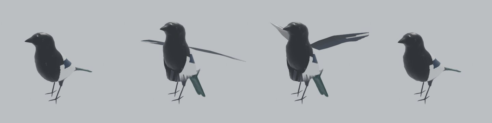

# Magpie (saksagan)

The magpie that whispers to the crowd (S07, S10, S15, S23): `public/v2/saksagan/magpie.glb`, 0.11 MB, 5,084 triangles, 3 draw calls (body and two open wings), one 512 px body texture and one wing picture, Draco and KTX2. Real size: 0.46 m from beak to tail tip, 0.29 m tall.



## Nodes

| Node | What |
|---|---|
| `magpie_root` | The node to place. Origin where the claws grip (put it on a wire, a lamp arm or a sill). Looks along +Z. |
| `magpie` | The armature: `root`, `body`, `head`, `tail`, `wing_L`, `wing_L_outer`, `wing_R`, `wing_R_outer`. |
| `magpie_body` | The bird with its folded wings (skinned). |
| `magpie_wing_L`, `magpie_wing_R` | The open wings (skinned, double-sided). They grow out of the shoulders in `flap` and are shrunk to nothing in the other clips. |
| `perch_grip`, `head_top`, `beak_tip`, `tail_tip` | Points: the grip (= origin), the top of the head, the beak tip (for a word balloon or a spark in the beak, S10) and the tail tip. |

## Clips

All in place (the game moves `magpie_root`):

| Clip | Length | Loops | What |
|---|---|---|---|
| `idle` | 4 s | yes | Perched: looks right, then left, flicks its tail twice, breathes. |
| `flap` | 1 s | yes | Wings open, three beats a second, body up, tail down: for flying from perch to perch or hovering. Cross-fade from `idle` over 0.15 s. |
| `talk` | 2 s | yes | Bobs its head and tail, as if muttering ("The bank is empty… empty…"). The beak does not open. |

```ts
const gltf = AssetManager.getGLTF('magpie');
const mixer = new AnimationMixer(gltf.scene);
const idle = mixer.clipAction(AnimationClip.findByName(gltf.animations, 'idle')).play();
```

## Made from

A CC BY sculpt of a magpie ("P. pica sericea" by wsh901224, see sources.json), which had no colours: it was coloured here by region, turned, scaled, reduced, baked into one texture and rigged. The open wings and their picture are drawn here.

```bash
nice -n 20 blender -b --factory-startup --python art/v2/kuslar/paint_magpie.py -- $V2_CACHE/sketchfab/36b97734e6e6437092707e82125ac902.glb /tmp/magpie_painted.glb
```

```bash
nice -n 20 blender -b --factory-startup --python art/v2/tools/prep_model.py -- --in /tmp/magpie_painted.glb --out /tmp/magpie_body.glb --name magpie --tris 5000 --tex 512 --scale 1.0 --bake 512 --rough 0.45
```

```bash
python3 art/v2/kuslar/wing_textures.py /tmp/wings
```

```bash
nice -n 20 blender -b --factory-startup --python art/v2/kuslar/rig_bird.py -- magpie /tmp/magpie_body.glb /tmp/wings/magpie_wing.png /tmp/magpie_raw.glb --preview /tmp/prev
```

```bash
node art/v2/tools/pack.mjs /tmp/magpie_raw.glb public/v2/saksagan/magpie.glb art/v2/saksagan/pack-report.json
```
