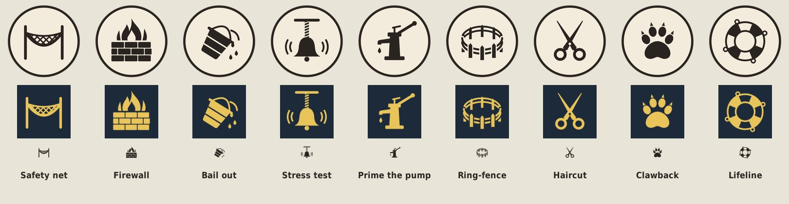

# Word icons (simge)

One plain picture per word, used the same everywhere: in the orb, on the feather, in Gray's gold word balloon, on the policy card, in the notebook and in the credits. No letters in them, so they read without English. Bold shapes, few parts: they still read at 28 px (see the bottom row of the preview).



| Key | Word | Picture | In the current scope |
|---|---|---|---|
| `safety_net` | Safety net | a net hung between two posts | yes (circus) |
| `firewall` | Firewall | a brick wall with a flame held behind it | yes (forest fire) |
| `bail_out` | Bail out | a bucket tipping water out | yes (ship) |
| `prime_the_pump` | Prime the pump | a hand pump with a drop at the spout | yes (farm) |
| `haircut` | Haircut | scissors | yes (hidden word) |
| `clawback` | Clawback | a paw print with claws | yes (hidden word) |
| `lifeline` | Lifeline | a lifebuoy | yes (hidden word) |
| `stress_test` | Stress test | a bell on a taut rope, ringing | no (mountain, not played) |
| `ring_fence` | Ring-fence | a ring of fence pickets | no (ice-age valley, not played) |

## Files (`public/v2/simge/`)

| File | What | Use |
|---|---|---|
| `<key>.png` | White picture on transparent, 512 x 512 | Tint it: `new MeshBasicMaterial({ map, color: 0xe8c45a, transparent: true })` gives a gold icon for the balloon or orb; ink `0x2a2420` for paper. White multiplies to any colour. |
| `<key>_badge.png` | Ink picture on a cream disc with an ink ring, 512 x 512, transparent outside the disc | Ready to show as it is: feather tip, card corner, notebook margin, credits. Reads on any background. |
| `svg/<key>.svg` | The picture as SVG, one colour (`currentColor`, ink by default), 256 x 256 viewBox | Canvas drawing (policy card, notebook page): `drawImage` of the SVG at any size stays sharp. Change the colour by replacing `color:#2a2420`. |
| `svg/<key>_badge.svg` | The badge as SVG | Same. |

Colours: ink `#2a2420`, cream `#f3ecdc`; the gold in the preview is the feather gold the code already uses (`0xe8c45a`). The whole folder is 0.54 MB. PNGs (not KTX2) so they load with a plain `TextureLoader` or ``; mipmaps keep them clean at a distance.

## Rebuilding

The pictures are drawn in code (no outside sources):

```bash
python3 -P art/v2/simge/make_icons.py
```

writes the SVGs into `art/v2/simge/svg/`. The PNGs are those SVGs at 512 px, rendered by headless Chrome with a transparent background (the white set with `color:#ffffff`):

```bash
"/Applications/Google Chrome.app/Contents/MacOS/Google Chrome" --headless=new --force-device-scale-factor=1 --window-size=512,512 --default-background-color=00000000 --screenshot=out.png file:///path/to/icon_512.svg
```
