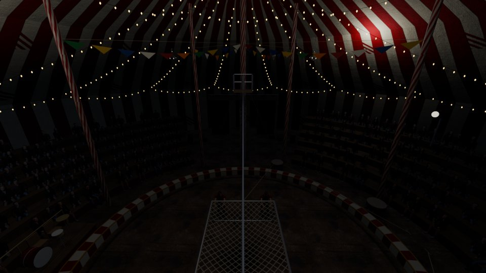
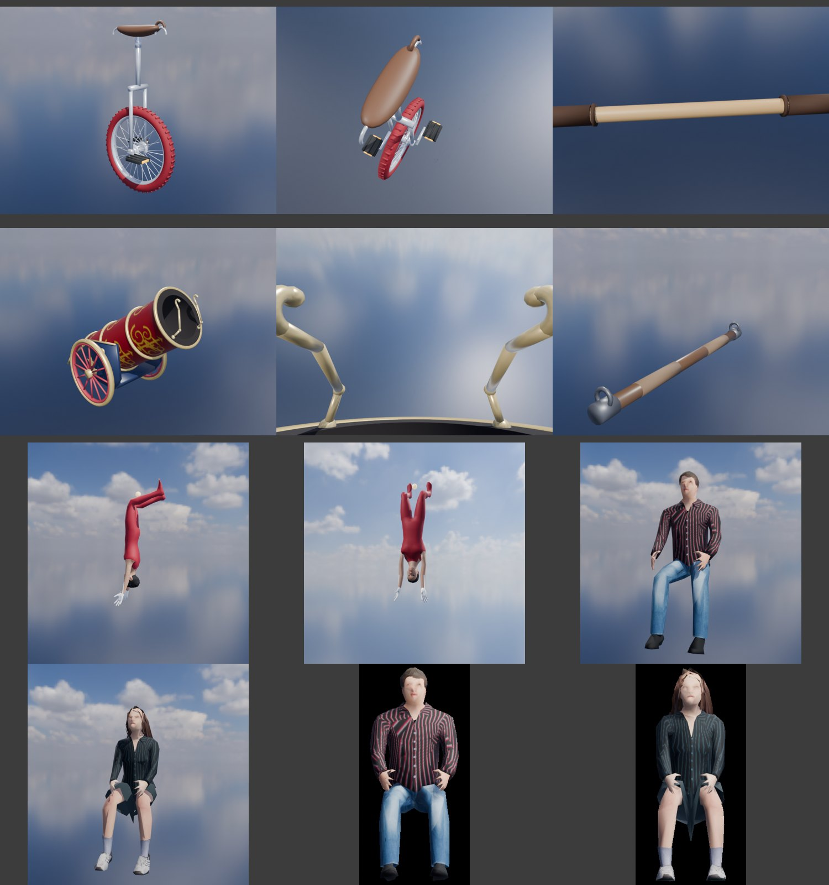

# Circus big top: Safety net (sirk)

Inside a red-and-cream big top: a high wire 6 m up between two platforms, and below it a safety net on wheels. The player sits on the sawdust just outside the ring and pulls two ropes to slide the net under the falling acrobats. Empty bleachers all round, follow spots, hanging lamps, bunting, pedestals; the performers' entrance is a curtain on the east side.

- Game file: `public/v2/sirk/sirk.glb` (1.85 MB, Draco + KTX2; loading as in `art/v2/mahalle/README.md`)
- Build: `art/v2/sirk/build.py`; prints from `art/v2/tools/textures_sirk.py`
- Previews: `art/v2/sirk/preview/*.jpg`; numbers: `stats.json`, `pack-report.json`

Units metres, glTF Y-up, build-script north = three.js -Z. Floor y = 0, ring centre at the origin.

## Budget

About 53,000 triangles and 52 draw calls with the full house (34 seated people in the front tier, 480 pictures behind them), 1.4 MB of textures, 1.85 MB in all. With the act props (unicycle, pole, cannon, two trapezes, catcher: about 23,000) the circus stays near 76,000 of its 120,000 triangles. The house is in the file now, so the game need not seat its own crowd (`spectator_*.glb` remain for a crowd it animates itself).

## Named nodes

| Node | What | Pivot / notes |
|---|---|---|
| `safety_net` | net (alpha-masked cords), metal frame 3.6 x 3.0 m at 1.45 m, four legs on casters | floor, centre of the net. Slide it along X (three.js X too) between `net_limit_left` and `net_limit_right` (x = -4.6 .. 4.6); the sagging net surface is 1.03-1.45 m high |
| `high_wire` | steel cable from x = -6.7 to 6.7 at 6.02 m | static; can sway in stage 3 |
| `net_line_left`, `net_line_right` | rope from each pulley to the net's side | pivot at the pulley; the mesh runs along local +Y, rest length 6.42 m. To follow the net: point local +Y at the net's side (net centre ± 1.8 m in X, 1.45 m up) and scale Y by distance / 6.42 |
| `net_rope_left`, `net_rope_right` | rope from each pulley to the player's handle | pivot at the pulley, along local +Y, rest length 8.41 m |
| `rope_handle_left`, `rope_handle_right` | wooden T-grips, 0.28 m, at hand height in front of the seat | grip centre; pulling a handle toward the player moves the net to that side |

## Points

| Point | Where |
|---|---|
| `seat_ringside` | floor point of the player's seat, 7.6 m south of the wire, facing north (forward = local -Z). The handles are 0.6 m ahead at 0.95 m, ±0.45 m left and right |
| `acrobat_start_1` … `_3` | on the wire at x = -3.6, 0.4, 3.9 (stage 1 uses one, stage 3 all three) |
| `spot_platform_left`, `spot_platform_right` | platform tops, facing the wire |
| `pulley_left`, `pulley_right` | the two pulleys at the ring's edge |
| `net_limit_left`, `net_limit_right` | ends of the net's travel |

## The full house, the bulbs, the band and the net crew (added 18 Nov)

| Node | What | Notes |
|---|---|---|
| `bulb_string` | warm bulbs on cords: sixteen lines from the king poles down to the wall, a garland round the wall top, swags between the quarter poles over the ring | one draw, emissive (strength 4, glTF `KHR_materials_emissive_strength`); its own node so the game can dim or flicker it. The cords are part of the static tent |
| `crowd_near` | every other seat of the front tier: 34 seated people (the two spectators of `spectator_*.glb`), facing the ring | each person tinted a little by vertex colour (`COLOR_0`), so the house is not one costume; hide it if the game seats its own animated crowd |
| `crowd_far` | the other seats (480): the spectators as pictures on upright quads facing the ring | one alpha-cut draw (MASK), vertex-coloured like the front tier |
| `net_crew_1` … `net_crew_4` | four circus hands in maroon overalls leaning into the net's corners | children of `safety_net`, so they slide with it; each has a soft floor shadow (`net_crew_*_shadow`) |
| `safety_net_shadow` | a soft dark patch under the net | child of `safety_net` |
| (static) `contact_shadows` | soft dark discs where poles, pedestals, crates, barrels and masts meet the sawdust, and a dark band along both sides of the ring curb | one alpha-blended draw; things now sit on the floor instead of floating on it |
| (static) the bandstand | north of the ring, at three.js x 0, z -7.75: red skirted platform, bass drum, snare on its stand, cymbal, two chairs, brass rail | point `drummer_seat` is the drummer's seat, facing the ring |



## Notes for the game

- No lights in the file. The canvas reads warm with one strong light under the roof and two spots on the wire; the follow-spot lenses (`spot_lens`) and lamp glass are emissive.
- The net material is alpha-masked (cutout, glTF MASK), double-sided; so are the far crowd and the people's hair. The contact shadows are the one alpha-blended material.
- Wind in stage 3 can sway `safety_net` and `high_wire`; the tent itself is static.

## Rebuilding

```bash
python3 art/v2/tools/fetch_tex.py "$V2_CACHE" 1k aerial_wood_snips brown_planks_05 velour_velvet fabric_pattern_07
```

```bash
python3 -P art/v2/tools/textures_sirk.py "$V2_CACHE/gen"
```

```bash
V2_CACHE=<cache> nice -n 20 blender -b --factory-startup --python art/v2/sirk/build.py -- /tmp/sirk_raw.glb --preview /tmp/prev --crowd /tmp/circ
```

`--crowd` is a folder with the raw people from `pose.py` (below): `spectator_man_raw.glb`, `spectator_woman_raw.glb`, their two `_impostor.png` pictures and `net_crew_raw.glb` (the circus hand of `people.json`, pose `pushing`). Without it the house stays empty and there is no net crew.

```bash
node art/v2/tools/pack.mjs /tmp/sirk_raw.glb public/v2/sirk/sirk.glb art/v2/sirk/pack-report.json
```

Models: `bash art/models/fetch_polyhaven.sh <id> "$V2_CACHE/<id>" 1k` for each Poly Haven id in `sources.json`.

## Props and people for the three acts (S06): `props.py`, `pose.py`

Each in its own file in `public/v2/sirk/`, to take the place of the shapes the game builds today (`circus-show.ts` `buildUnicycle`, `buildPole`, `buildCrowd`; `circus-cannon.ts` `buildCannon`; `circus-trapeze.ts` `buildTrapeze`, `buildCatcher`). Sizes, pivots and node names follow those functions, so the game's logic stays as it is. three.js metres, Y up. Metals are kept at 0.55-0.6 metalness, because the tent has no environment map and a full metal shows black there.



| File | Triangles | Draw calls | Replaces |
|---|---|---|---|
| `unicycle.glb` | 4,680 | 9 | `buildUnicycle` |
| `balance_pole.glb` | 1,372 | 5 | `buildPole` |
| `cannon.glb` | 8,152 | 10 | `buildCannon` |
| `trapeze.glb` | 576 | 4 | `buildTrapeze` (use twice) |
| `catcher.glb` | 7,350 | 8 | `buildCatcher` |
| `spectator_man.glb`, `spectator_woman.glb` | 797, 796 | 2 each | `buildCrowd` (near rows) |
| `spectator_man_impostor.png`, `spectator_woman_impostor.png` | 2 per person | 1 | `buildCrowd` (far rows) |

All together (one of each prop, two trapezes, the catcher, 40 near spectators, 200 more as pictures) about 55,000 triangles; with `sirk.glb` about 67,000 of the 120,000 the act may use.

**unicycle.glb**: origin where the tyre meets the wire; it rolls along +x.
- `Unicycle`: the root (frame, fork, seat post, saddle with a front handle and chrome bumpers; saddle top 0.95 m).
- `UnicycleWheel`: at the hub, 0.25 m up; turn it about its local z (`rotation.z = -along / 0.25`, as now). Red tyre with a tread, chrome rim, 32 crossed spokes, hub, cranks 0.115 m.
- `Pedal left` (z -0.135), `Pedal right` (z +0.135): children of the wheel at the crank ends; counter-turn them to stay level, as now.

**balance_pole.glb**: 2.4 m of honey-coloured wood along local z, its middle at the origin.
- `BalancePole`: the root. `PoleGrip left` (z -0.25), `PoleGrip right` (z +0.25): empties at the leather grips' middles, for the hands.
- `PoleWeight left`, `PoleWeight right`: the lead weights at the ends (z ∓1.2), separate meshes so the game can light them (their material is its own).

**cannon.glb**: origin at the middle of the muzzle; the flyer sits in the mouth facing +x.
- `Cannon`: the root (navy carriage with gold trim and stars, two red-and-gold wheels 0.68 m in radius whose axle is at (-1.6, -1.35, 0), as now).
- `CannonBarrel`: turns about the muzzle (`rotation.set(0, -yaw, pitch)`, as now); the barrel lies along -x, 2.7 m, red lacquer with gold scrollwork and four gold bands, dark bore, open mouth 0.4 m in radius.
- `CannonHandle left`, `CannonHandle right`: brass horn grips, origin at the grip, at (0.23, 0.15, ∓0.25) in the barrel's frame, where the game puts them now; the brass arms that carry them from the lip are part of the barrel.

**trapeze.glb**
- `TrapezeBar`: 0.9 m along local z, origin at its middle; dark wood, leather grips, iron end fittings with the rope eyes at z ±0.42 (where the game's ropes end).
- `TrapezeRope`: a rope 1 m long from its origin up +y (twisted-rope picture); stretch it between beam and bar as the game's `rod()` is stretched (`scale.y` = length). Two per trapeze.

**catcher.glb**: hanging by his knees, head down, arms reaching down toward the flyer; red leotard over trunk and legs, chalked hands and wrists. A MakeHuman person (CC0, `people.json`) posed still and baked (no skeleton). Origin on the bar in the crook of his knees; he faces -x (toward the flyer), the bar runs along z.
- `Catcher`: the root. `catcher_skin` (body with the leotard), `catcher_outfit` (eyes), `catcher_hair`.
- `CatcherHand left`, `CatcherHand right`: the chalked hands and 7 cm of wrist wrap, separate meshes with their own material, to light in the dark flight.
- `catcher_palm_left`, `catcher_palm_right`: empties at the palms, at (-0.224, -1.355, ∓0.22). The game's `TRAPEZE.catcherReach` is 1.45; with this body the palms are 1.355 m below the bar, so 1.36 would put the catch where the hands are.
- `CatcherLamp`: a small warm lamp 0.12 m over the bar (as the game's).

**spectator_man.glb, spectator_woman.glb**: seated, looking up toward the wire, hands on the thighs (the crowd people of `art/v2/insan`, posed still). Origin on the seat under the middle of the hips, facing +z; the feet rest about 0.42 m below the seat, on the step below. `spectator_body` (skin and clothes in one 512 atlas) and `spectator_hair` (alpha-cut), so each file is two `InstancedMesh` draws; instance colours tint the clothes. For the far rows, `spectator_*_impostor.png` (256 × 512, transparent round the figure) on camera-facing quads: the picture covers 0.73 × 1.47 m and the seat is 0.47 m above its bottom edge (`spectator_*_impostor.json`).

Rebuilding:

```bash
python3 -P art/v2/sirk/props_textures.py /tmp/sirk_tex
```

```bash
nice -n 20 blender -b --factory-startup --python art/v2/sirk/props.py -- unicycle /tmp/unicycle_raw.glb /tmp/sirk_tex --preview /tmp/prev
```

(the same for `balance_pole`, `cannon`, `trapeze`). The people, with MPFB set up as in `art/v2/insan/README.md`:

```bash
BLENDER_USER_RESOURCES=<dir> V2_CACHE=<cache> nice -n 20 blender -b --python art/v2/insan/build.py -- catcher /tmp/catcher_raw.glb --stage joined --spec art/v2/sirk/people.json
```

```bash
nice -n 20 blender -b --python art/v2/sirk/pose.py -- /tmp/catcher_joined.blend catcher /tmp/catcher_raw.glb --preview /tmp/prev
```

```bash
BLENDER_USER_RESOURCES=<dir> V2_CACHE=<cache> nice -n 20 blender -b --python art/v2/insan/build.py -- crowd_man_casual /tmp/crowd_man_casual_raw.glb --stage joined
```

```bash
nice -n 20 blender -b --python art/v2/sirk/pose.py -- /tmp/crowd_man_casual_joined.blend seated /tmp/spectator_man_raw.glb --impostor /tmp/spectator_man_impostor.png
```

(`crowd_woman_b` for the woman). Then `node art/v2/tools/pack.mjs /tmp/<name>_raw.glb public/v2/sirk/<name>.glb` for each.
